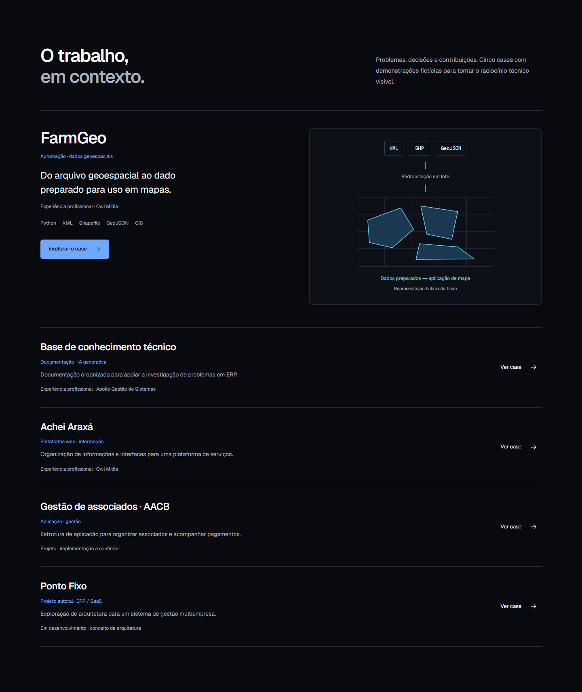
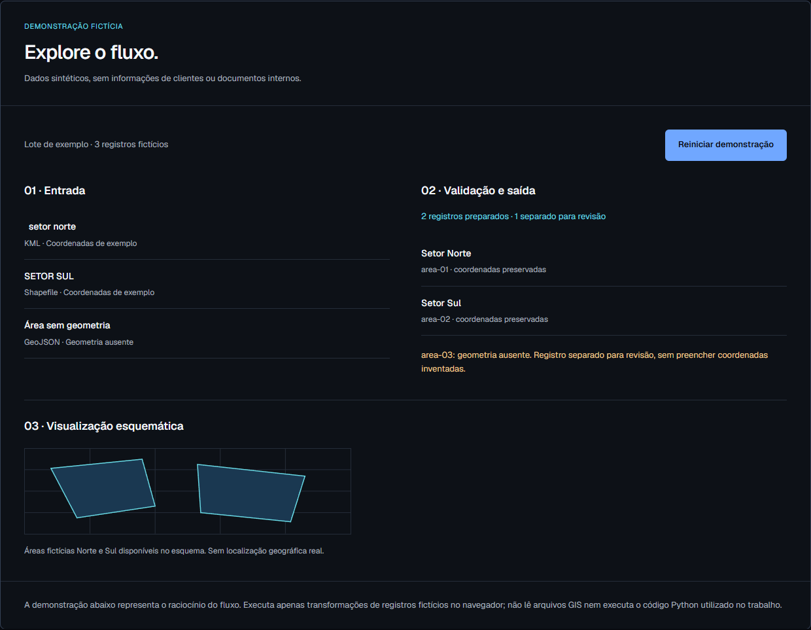

# Wederson Ferreira · Portfólio
Portfólio em português para back-end, automação e dados, feito com Next.js App Router, TypeScript, React e Tailwind CSS.

## Executar
Use Node.js 24 e npm. A versão está registrada em `.nvmrc` e `package.json`.
```bash
npm ci
npm run dev
npm run lint
npm run build
npm run start
```
O desenvolvimento usa http://localhost:3000. `npm ci` reproduz o lockfile. A instalação limpa e o build foram verificados com Node 24.19.0.

Se o cache global do npm não puder ser escrito:
```bash
npm ci --cache .npm-cache --prefer-offline --no-audit --no-fund
```
Em caso de conexão instável, repita esse comando com `--maxsockets=3 --fetch-retries=1 --fetch-timeout=60000`. Não apague o lockfile para contornar falhas de rede.

## Conteúdo e rotas
A home reúne posicionamento, fluxo técnico animado, cinco cases, sobre, processo interativo, stack por função, experiência, contato, currículo e footer.

| Case | Rota | Demonstração |
| --- | --- | --- |
| FarmGeo | /projetos/farmgeo | Padronização de registros e separação de geometria ausente |
| Base de conhecimento | /projetos/base-conhecimento | Consulta a documentos fictícios e resposta sem evidência |
| Achei Araxá | /projetos/achei-araxa | Categorias de serviço e orientação predefinida |
| AACB | /projetos/aacb | Filtro de associados e histórico fictício |
| Ponto Fixo | /projetos/ponto-fixo | Mudança de contexto de empresa e consulta local |

Todas as demos têm identificação visível de **demonstração fictícia** e descrição dos limites. São interações no navegador, sem processamento GIS real, chamadas de IA, autenticação, pagamentos, persistência ou comprovação de isolamento multiempresa.

## Organização
- `app/`: home, cases estáticos, página 404, metadata, robots, sitemap e imagem Open Graph.
- `components/`: navegação, seções, fluxo SVG, footer e demos.
- `data/`: perfil, processo, stack, cases e experiência.
- `lib/`: URL pública e disponibilidade do currículo.
- `docs/`: plano, validação, publicação e screenshots.
- `DESIGN.md` e `.impeccable/design.json`: sistema visual do projeto.

A home conserva seções predominantemente estáticas. O JavaScript interativo fica na navegação, fluxo, processo e demos dos cases. Os cinco cases são gerados durante o build.

## Currículo
Coloque o PDF final em `public/curriculo-wederson-ferreira.pdf` e faça novo build/deploy. O link de download só aparece quando o arquivo começa com a assinatura PDF. Isso evita oferecer um download inexistente; não substitui a revisão do documento. Sem o arquivo, a interface informa a indisponibilidade e oferece contato por e-mail.

## SEO e publicação
Configure `NEXT_PUBLIC_SITE_URL` com a URL pública HTTPS do portfólio, sem caminho, após criar o projeto. Use `.env.example` como referência. Faça novo deploy ao alterar a variável.
- Sem URL configurada, a versão inicial usa `noindex` e `robots.txt` bloqueia indexação.
- Com URL configurada, são gerados canonical e sitemap com home e cinco cases.
- Previews com `VERCEL_ENV=preview` continuam fora da indexação.
- Metadata por case, idioma pt-BR, JSON-LD Person e imagem Open Graph estão implementados.

Leia [o guia de GitHub e Vercel](docs/PUBLICACAO.md). O workflow valida lint e build; `vercel.json` prepara a importação como Next.js. Não há credenciais no projeto. Repositório remoto e publicação precisam ser conectados na conta do proprietário.

## Screenshots



As capturas mobile também estão em [docs/screenshots](docs/screenshots). Os resultados e limites da validação estão em [docs/VALIDACAO-FINAL.md](docs/VALIDACAO-FINAL.md).

## Informações ainda pendentes
PDF final do currículo; URL pública; repositórios e recursos implementados de AACB/Ponto Fixo; cargos, períodos e contribuições da startup confidencial e Unz Company; atividades corretas da experiência na Algar. Nenhuma dessas informações foi inventada. Os períodos simultâneos fornecidos foram preservados.

A integração de um formulário ou backend não é necessária para o contato atual: o e-mail usa `mailto:`, com GitHub e LinkedIn públicos.
